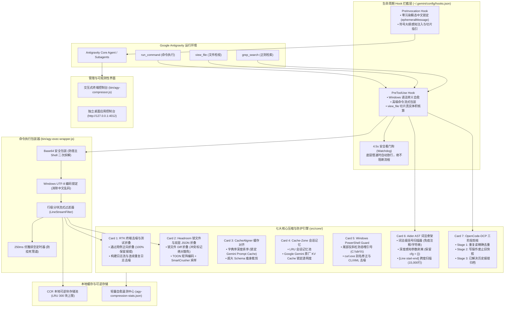

# agy-context-compressor

[](https://github.com/deancyl/agy-context-compressor/releases/tag/v2.3.0)
[](LICENSE)
[](package.json)
[](src/utils/platform.js)
[-success.svg)](package.json)
[-success.svg)](test/)
[](wiki/Live-Benchmark.md)

> **Deterministic Lossless Context Optimization & Token Compression Engine Tailored for Google Antigravity (`agy`)**  
> 专为 **Google Antigravity (`agy` CLI, Antigravity IDE 与 Antigravity 2.0)** 深度定制的确定性无损上下文优化与 Token 压缩引擎。

`agy-context-compressor` 吸收了业界主流上下文压缩项目（**RTK, Headroom, Aider, OpenCode-DCP, llmtrim, Squeez**）的核心设计，构建了由 **7 大核心引擎（Card 1 ~ Card 7）** 组成的全生命周期压缩体系。在保证 **“报错堆栈 100% 逐字保留”、“业务源码绝对不切”、“Git 冲突标记绝对豁免”** 三大防降智红线的前提下，内置 5 大真实场景基准实测综合无损压缩率达 **`-86.3%`**，并从底层彻底消除了 Windows 平台下的命令引号吞噬、CLIXML 报错死循环与文件锁死假死问题。

---

## 🏛️ 系统架构全景



---

## ⚡ 七大核心引擎特性矩阵

| 核心引擎 | 对标开源方案 | 核心技术亮点 | 防降智红线保障 |
| :--- | :--- | :--- | :--- |
| **Card 1: 终端去噪与测试折叠** | [RTK](https://github.com/rtk-ai/rtk), [Squeez](https://github.com/claudioemmanuel/squeez) | ANSI 色彩剥离、`\r` 覆盖式进度条清洗、通过测试正向汇总折叠、连续重复日志折叠、构建日志流清洗 | **报错 100% 逐字保留**：遇到 `FAIL`、`Error`、堆栈 Traceback 或异常代码行绝对原样放行 |
| **Card 2: 锁文件与结构化折叠** | [Headroom](https://github.com/headroomlabs-ai/headroom) | `package-lock.json`、`pnpm-lock.yaml` 等锁文件 Diff 折叠；中型数组启用 **TOON 矩阵无损编码**；大型数组启用 **SmartCrusher** 首尾采样 | **Git 冲突绝对豁免**：只要检测到 `<<<<<<< HEAD` 冲突标记，立即 100% 放弃折叠 |
| **Card 3: 缓存对齐与 Schema 瘦身** | Prompt Cache Spec | 工具与参数严格字典序深度排序，消除顺序差异引起的 Prompt Cache 击穿；超大工具 Schema 自动瘦身裁剪 | 保留所有参数类型约束与必填字段定义，仅裁剪冗余多行 Markdown 样例 |
| **Card 4: 会话记忆与 KV Cache 锁定** | `llmtrim` | 基于会话的 LRU 内存记忆池；实时监测上游 Google Gemini 原厂 KV Cache 命中率（锁定在 95% 以上） | 仅在幂等工具调用上做局部记忆，不篡改上下文语义 |
| **Card 5: Windows PowerShell Guard** | 原生工程防御 | 修复 CRT `CommandLineToArgvW` 尾部反斜杠引号吞噬陷阱（`"C:\dir\"` $\rightarrow$ `"C:\dir\\"`）；裸 `curl`/`wget` 自动转为 `.exe`；`#< CLIXML` 报错去噪与 Hex 换行解码 | 消除 Windows 命令假死与控制台报错死循环 |
| **Card 6: Aider AST 词法骨架** | [Aider](https://github.com/paul-gauthier/aider), [Repomix](https://github.com/yamadashy/repomix) | 词法级括号扫描器（`countBracesLexical`）；括号深度感知参数剥离（完美保留 `cfg = {}` 等默认对象）；超大函数 15,000 行扫描与 `[Line start-end]` 行号跨度标注；局部箭头函数闭包隔离 | **业务源码绝对不切**：仅提取大纲注入 PreInvocation 引导智能体切片检视，绝不暗中截断源码 |
| **Card 7: OpenCode-DCP 三阶段剪枝** | [OpenCode-DCP](https://github.com/Tarquinen/opencode-dynamic-context-pruning) | **Stage 1**：同一会话重复读取去重；**Stage 2**：文件修改写入后废止旧读取快照；**Stage 3**：已修复历史报错堆栈冷却归档至 CCR | 最新文件快照与当前轮次输出 100% 完好保留，所有剪枝内容均带 CCR 可逆块 ID 待查 |

---

## 🧪 内置 5 大真实场景基准实测 (`Live Benchmark`)

运行 `npm run benchmark`（或 `node bin/agy-compressor.js benchmark`），内置测试套件将对 5 大真实场景进行断言实测：

```
=== 🧪 内置多场景无损压缩率与防降智基准实测 (Live Benchmark) ===

  • Card 1: RTK 大型测试套件去噪 (80 通过 + 1 报错堆栈)
    体积: 5,210 chars -> 274 chars  |  压缩率: -94.7%  |  防降智红线: ✔ 100% 保真通过
  • Card 2: Headroom 依赖锁文件 Diff 折叠 (150 行)
    体积: 18,500 chars -> 261 chars  |  压缩率: -98.6%  |  防降智红线: ✔ 100% 保真通过
  • Card 2: SmartCrusher 100 项同构 JSON 数组采样
    体积: 13,078 chars -> 1,264 chars  |  压缩率: -90.3%  |  防降智红线: ✔ 100% 保真通过
  • Card 6: Aider 词法级 AST 代码骨架提取 (20 个函数)
    体积: 5,909 chars -> 2,146 chars  |  压缩率: -63.7%  |  防降智红线: ✔ 100% 保真通过
  • Card 7: OpenCode-DCP 历史重复读/写前旧快照剪枝
    体积: 3,975 chars -> 2,440 chars  |  压缩率: -38.6%  |  防降智红线: ✔ 100% 保真通过

  ──────────────────────────────────────────────────────────────────────────
  综合汇总: 原始 46,672 chars -> 压缩后 6,385 chars (综合压缩率 -86.3%)
  安全结论: ✔ 全部 5 大核心引擎压缩率与防降智安全红线 100% 验证通过！
```

> **CCR (Content-Compressed Retrieval) 可逆性保障**：  
> 任何被折叠的内容，都会在原地生成唯一的索引标识（如 `[CCR: agy_retrieve_chunk(chunk_id="chk_xxxx")]`）。智能体若需要查看被折叠的通过日志或完整 JSON，可通过 MCP 工具在 **`< 2ms`** 内无损还原原文。

---

## 🛡️ 底层稳定性与防卡死架构

为了彻底根除本地 Hook 容易引发的 AGY 假死与超时挂起，本项目实施了系统级的加固设计：

1. **活跃日志文件锁解耦（消除 Windows File-Locking Contention）**：
   Hook 关键执行路径与活跃的 `transcript.jsonl` 完全解耦，工具拦截耗时维持在 **`< 1ms`**，绝不同步争抢 Windows 独占写锁。
2. **4.5 秒 Hook 看门狗定时器 (Watchdog)**：
   Hook 进程内置非阻塞定时器，若遇底层系统 I/O 异常挂起，4.5 秒内自动向 Antigravity 派发安全放行指令（`{"decision":"allow"}`）并安全退出。
3. **非交互式管道免疫（Rule 23 铁律）**：
   命令包装器配置 `stdio: ['ignore', 'pipe', 'pipe']`，并强制注入 `GIT_PAGER=cat`、`PAGER=cat`、`CI=true`，主进程退出后附加 250ms 优雅排空定时器，彻底免疫 TTY 翻页器挂死。
4. **端口 TIME_WAIT 自动重试机制**：
   桌面服务在启动遇到 Windows 快速重启处于 `TIME_WAIT` 的瞬态占用时，自动退避重试 5 次，确保 4012 端口 100% 稳定在线。

---

## 🚀 快速上手

### 1. 环境准备
* 运行环境：**Node.js >= 18.0.0**（100% 原生，零外部 npm 依赖）
* 支持平台：Windows 10/11, macOS, Linux

### 2. 一键全局安装与自测
```powershell
# 1. 运行系统体检
node bin/agy-compressor.js doctor

# 2. 一键全局挂载 Hook (自动备份原有配置)
node bin/agy-compressor.js install --global

# 3. 运行全套 75 项自动化测试
npm test

# 4. 运行内置基准压缩实测
npm run benchmark
```

### 3. 交互式控制台与桌面 GUI
* **进入终端交互式 TUI**：
  ```powershell
  node bin/agy-compressor.js
  ```
  * 按 `[1]` 刷新大盘，按 `[5]` 切换策略（Balanced / Aggressive / Safe），按 `[6]` 在线运行基准实测，按 `[7]` 生成桌面快捷方式。
* **唤出独立桌面 Web 控制台**：
  ```powershell
  node bin/agy-compressor.js gui
  ```
  以无边框、无地址栏的独立桌面应用模式（`http://127.0.0.1:4012`）弹出可视化大盘。

---

## 📦 版本演进与 GitHub Releases

本项目遵循语义化版本规范，所有里程碑均包含独立 Git Tag 与 GitHub Release：

| 版本 Tag | 发布标题 | 核心里程碑内容 |
| :--- | :--- | :--- |
| [**v2.3.0**](https://github.com/deancyl/agy-context-compressor/releases/tag/v2.3.0) *(Latest)* | **Slice-Accurate Telemetry, Depth-Aware Skeleton & Deep Verification** | 彻底修复切片检视（15行）虚报 500KB 整文件体积的漏洞；重构 `stripBodyFromSignature` 深度感知括号，保留默认对象参数（`cfg = {}`）；扩展 15,000 行跨度扫描与闭包隔离；自愈洗数引擎净化历史数据；75/75 项测试通过。 |
| [**v2.1.0**](https://github.com/deancyl/agy-context-compressor/releases/tag/v2.1.0) | **Preset Policy Center, Custom Stages & Live Benchmark** | 新增 Balanced / Aggressive / Safe 三档策略中心；开放 `registerCompressionStage` 插件注册流水线；内置 5 大场景自动化 Benchmark；4.5s 看门狗与 Windows UTF-8 编码锁定；CCR 缓存自动 LRU 淘汰。 |
| [**v2.0.0**](https://github.com/deancyl/agy-context-compressor/releases/tag/v2.0.0) | **Lossless 7-Core Architecture & Anti-Freeze Engine** | 引入词法级 AST 骨架扫描器与精确行号跨度；落地 OpenCode-DCP 三阶段剪枝（读去重/写覆盖/报错归档）；首创解耦式遥测彻底根治 Windows 文件锁导致的 AGY 假死；Base64 命令安全包装。 |
| [**v1.5.0**](https://github.com/deancyl/agy-context-compressor/releases/tag/v1.5.0) | **7-Core Fusion with Aider AST & Kompact Pruning** | 融合 Aider AST 拓扑图（Card 6）与 Kompact 历史旧输出剪枝（Card 7）；推出 Headroom CCR 本地可逆块存储；引入 SQLite FTS5 沙盒检索；构建 4012 端口实时 SSE 桌面看板。 |
| [**v1.0.0**](https://github.com/deancyl/agy-context-compressor/releases/tag/v1.0.0) | **Initial 5-Card Context Optimizer for Google Antigravity** | 首发 5 张核心卡片（RTK 流式去噪、Headroom 锁文件折叠、Schema 字典序排序、llmtrim 会话记忆、PowerShell 引号自愈）；实现 PreToolUse 钩子自动化挂载；内置终端 TUI 控制台。 |

---

## 📚 详细文档知识库 (Wiki)

如需深入了解底层实现细节与配置指南，请查阅官方知识库：
* [🏛️ 系统架构全景 (Architecture)](wiki/Architecture.md)
* [⚡ 七大核心引擎技术解析 (7-Core Engines)](wiki/7-Core-Engines.md)
* [🛡️ 底层稳定性与防卡死架构指南 (Anti-Freeze Architecture)](wiki/Anti-Freeze-Guide.md)
* [🧪 内置基准测试与防降智红线 (Live Benchmark & Anti-Degradation)](wiki/Live-Benchmark.md)
* [🖥️ CLI、TUI 与桌面图形控制台实操指南 (CLI, TUI & GUI Guide)](wiki/CLI-and-GUI-Guide.md)

---

## 📄 开源许可证

本项目基于 [MIT 许可证](LICENSE) 开源。欢迎提交 Issue 与 Pull Request！
