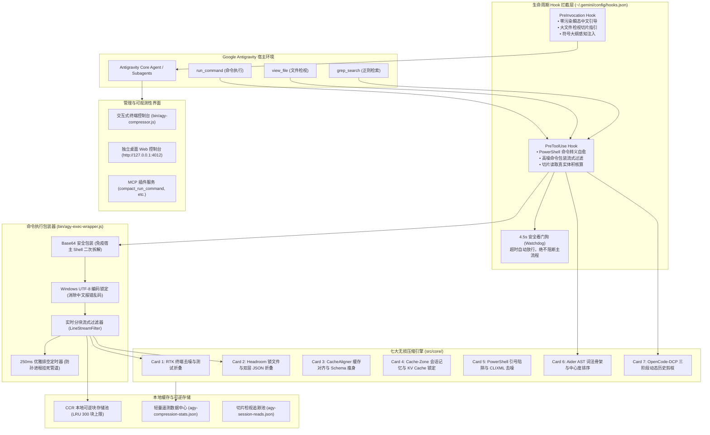

# 🏛️ 系统架构全景 (Architecture)

## 一、 整体技术架构图

---

## 二、 核心子系统职责

### 1. 生命周期 Hook 拦截系统
- **`PreToolUse` (工具前置拦截)**：
  - 在底层工具执行前拦截参数。
  - 对高频开发工具（npm, pytest, cargo, docker, git diff 等）自动附加 `agy-exec-wrapper.js` 流式去噪器。
  - 对 `view_file` 切片调用进行真实读取体积核算，杜绝分母稀释与虚增。
- **`PreInvocation` (推理前置引导)**：
  - 注入 `ephemeralMessage` 瞬态指令。
  - 瞬态提示仅在当前单轮交互生效，**绝不写入 `transcript.jsonl`**，从而锁定 Google Gemini 原厂 KV Cache 前缀，且彻底杜绝多智能体语言向英文漂移。

### 2. 命令执行包装器 (`bin/agy-exec-wrapper.js`)
- **Base64 完整封装**：将包含分号、管道符、连接符（`&&`）的多阶段命令完全打包，杜绝 Windows 宿主 Shell 将命令拆分执行两次的严重缺陷。
- **编码与环境变量保护**：自动注入 `[Console]::OutputEncoding = UTF8`、`PYTHONIOENCODING=utf-8`、`GIT_PAGER=cat`、`CI=true`，消除翻页器等待和乱码。
- **非交互式管道免疫**：配置 `stdio: ['ignore', 'pipe', 'pipe']`，彻底免疫交互式提示挂起。

### 3. 可逆存储与内容找回 (CCR: Content-Compressed Retrieval)
- 任何被折叠的大段文本（如 5,000 行通过日志或超大 JSON 数据），均会在本地计算 SHA-256 哈希并落盘至 CCR 块存储。
- 智能体在需要查阅原始全量细节时，可通过 MCP 工具 `agy_retrieve_chunk(chunk_id)` 毫秒级无损调阅。
